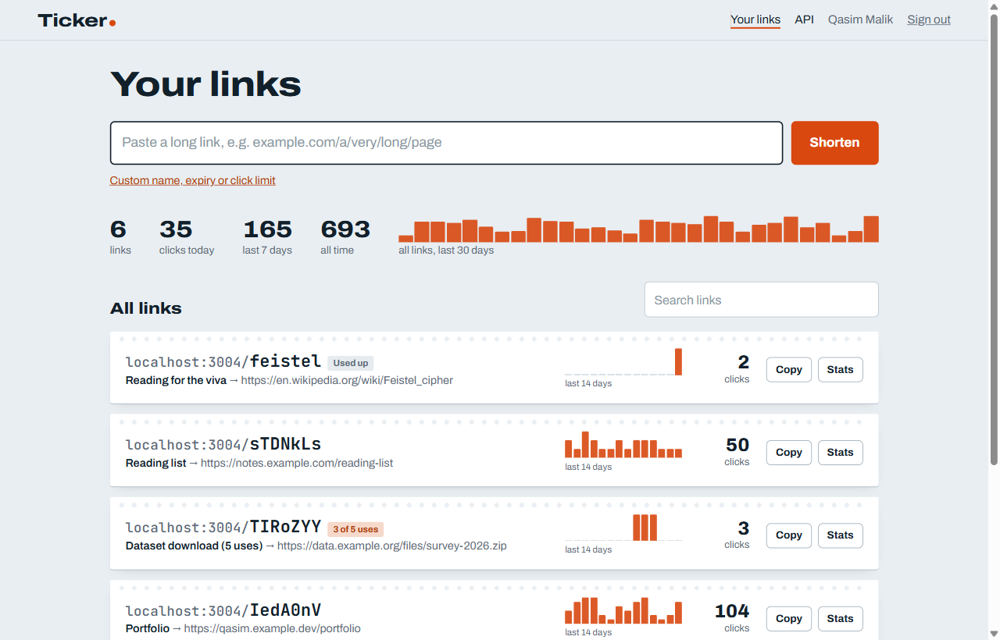
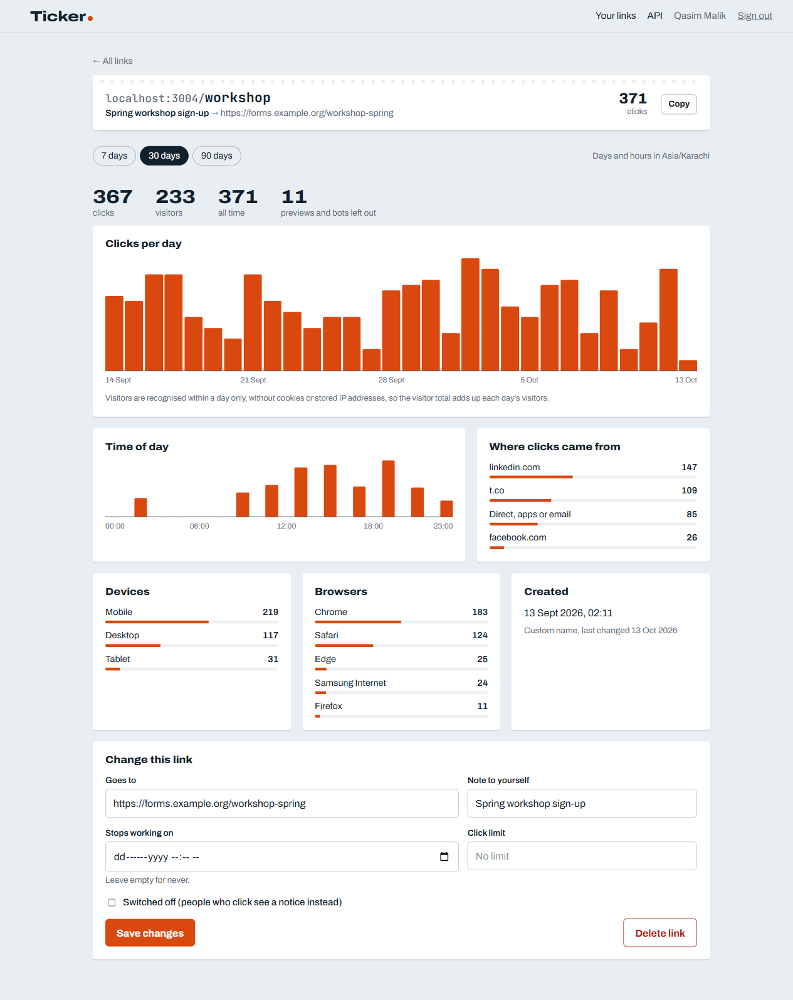

# Ticker

**A URL shortener with analytics: fast cached redirects, batched click logging, exact click limits and cookie-free unique visitors.**

[](https://github.com/qasimrazamalik-coder/ticker-url-shortener/actions/workflows/ci.yml)


[](LICENSE)

<p align="center">
  
  
</p>

Shorten a link, share it, and see who clicked: clicks per day, unique visitors, referrers, devices, browsers and time of day. Links can have a custom name, an expiry date or a click limit, and can be edited or switched off at any time.

A URL shortener looks trivial. The interesting part is that its two halves pull in opposite directions:

- the **redirect** has to be fast and must not depend on anything slow, and
- the **analytics** want to record every click, which is a write.

Ticker keeps the redirect path free of writes for ordinary links (in-memory cache, buffered click logging), and makes an exception exactly where correctness demands it: links with a click limit are counted synchronously and atomically, so "only 5 people may open this" holds even when 50 click at once.

Node.js 20, Express 5, PostgreSQL 16, plain SQL (no ORM), zod, JWT. The frontend is a small plain-JavaScript page served by the same app.

## Highlights

- **Short codes from a keyed Feistel permutation**: no collisions, no guessable order, no uniqueness retries
- **Redirects without database writes**: an LRU cache for lookups, clicks buffered and written in batches with `unnest`
- **Exact click limits**: 25 people clicking a 5-use link at once get exactly 5 redirects
- **Link previews never burn a one-time link** (WhatsApp, Slack, Telegram and crawlers are detected)
- **Unique visitors without cookies or stored IPs**: a daily rotating salt that is deleted afterwards
- **Rate limiting shared across instances**: a token bucket in a single atomic PostgreSQL statement
- **Time-zone-aware analytics** with zero-filled series, plus a daily rollup for account-wide totals

## Run it

You do not need to install PostgreSQL; a real Postgres server ships as a dev dependency.

```bash
npm install
npm run db        # terminal 1: starts PostgreSQL on port 5544 and keeps running
npm run setup     # terminal 2: creates the tables and loads a month of demo clicks
npm start         # http://localhost:3004   API docs at /api/docs
```

Or with Docker: `docker compose up --build`, then `docker compose exec api node scripts/seed.js`.

**Demo account:** `demo@ticker.test`, password `password123`. Try http://localhost:3004/workshop.

## Tests

```bash
npm test
```

Starts a throwaway PostgreSQL on a random port, migrates it, runs 43 tests (19 pure unit tests and 24 against the API and the real database) and removes it.

| Test | What it proves |
|---|---|
| ten thousand consecutive ids give ten thousand different codes | the code permutation never collides |
| the permutation is invertible and stays inside the code space | it is a true bijection on [0, 62^7) |
| RACE: 25 people click a 5-use link at once | exactly 5 redirects, 20 "used up", counter exactly 5 |
| RACE: ten people claim the same alias at once | exactly one gets it, nine get `ALIAS_TAKEN` |
| RACE: 15 link creations against a burst of 10 | exactly 10 succeed, 5 get 429 with `Retry-After` |
| a one-time link survives being previewed in a chat app | WhatsApp/Slack previews never use up a limit |
| changing the target takes effect on the very next click | the cache is invalidated on edit |
| a code looked up before it existed works once created | cached misses are invalidated too |
| a burst of clicks is written as one batch | 150 clicks, one flush, correct counters and rollup |
| visitors are recognised within a day without storing their IP | no IP anywhere in the click rows |
| days and hours follow the time zone you ask for | a 21:00 UTC click lands on the next day at 02:00 in Karachi |
| a deleted link's code is never handed out again | old printed links can't be hijacked |

## How it works

### Short codes without collisions or guessable order

The obvious scheme, base62 of the row id, hands out `0000001`, `0000002` ... so anyone can walk through every link and see how busy the service is. Random codes avoid that but need a uniqueness check and a retry on every insert, and the retries become more frequent as the code space fills.

Ticker passes the row id through a **keyed permutation** first (`src/modules/links/codes.js`):

- a 4-round **Feistel network** over 42 bits, with HMAC-SHA256 of the secret as the round function. A Feistel network is a bijection whatever the round function is, so distinct ids always give distinct outputs;
- **cycle walking**: 2^42 is a little above 62^7, so an output that lands outside the code space is permuted again until it fits. The result is still a bijection, now on exactly [0, 62^7);
- then base62, padded to 7 characters: 3.5 trillion codes.

So id 500 and id 501 give codes that look unrelated, and no collision check is ever needed between generated codes. Custom aliases share the same `code` column, so a generated code could in theory equal an alias someone chose earlier. The `UNIQUE` constraint catches that, and creation skips to the next id.

This hides ordering; it is not access control. Anyone holding a short link can open it, which is what expiry, click limits and switching off are for.

### The redirect path (`GET /:code`)

1. Look the code up in an **in-memory LRU cache** (`links/cache.js`, a `Map` used in insertion order). Misses are cached briefly too, so hammering a non-existent code does not turn into database load.
2. Unknown, switched-off or expired: a small HTML page with 404 or 410.
3. Links with a click limit only: one atomic statement

   ```sql
   UPDATE links SET click_count = click_count + 1
    WHERE id = $1 AND click_count < max_clicks
   ```

   Concurrent clicks queue on the row lock and each re-checks the condition against the latest count, so the limit can never be exceeded. Zero rows updated means "used up". A `CHECK (click_count <= max_clicks)` constraint backs this up in the schema.
4. Hand the click to the **buffer** (no database write) and answer `302` with `Cache-Control: private, no-store`.

Why 302 and not 301: browsers cache a 301 permanently, so later clicks would never reach the server (no analytics) and an edited link would keep sending people to the old target.

**Bots and link previews** (WhatsApp, Slack, Telegram, crawlers) are redirected but stored with `device = 'bot'`, left out of every statistic, and never use up a click limit. Otherwise pasting a one-time link into a chat would burn it before anyone clicked.

### Buffered click logging

`src/modules/clicks/buffer.js` collects clicks in memory and writes them every second, or as soon as 500 are waiting, in one transaction of three set-based statements, however many clicks the batch holds:

1. `INSERT INTO clicks SELECT * FROM unnest($1::bigint[], $2::timestamptz[], ...)`: all raw rows at once;
2. `INSERT INTO link_daily ... ON CONFLICT (link_id, day) DO UPDATE SET clicks = link_daily.clicks + excluded.clicks`: the daily rollup;
3. `UPDATE links ... FROM unnest(...)`: `click_count` for links without a limit. Rows are locked in id order first, so two server instances flushing at the same time cannot deadlock.

The trade-off is stated plainly: if the process crashes, up to one second of analytics is lost. Redirects never wait for an analytics write. Capped links are not exposed to this, because they are counted synchronously (and those clicks carry `counted: true`, so step 3 does not count them twice). On a clean shutdown the server stops accepting requests and then flushes. If the database is down, the buffer keeps clicks up to a bound and retries. A batch that keeps failing is dropped after 5 attempts rather than blocking every later click.

### Unique visitors without cookies or IP addresses

```
visitor = sha256(salt_of_the_day + ip + user_agent)[0:16]
```

The salt is random, one per UTC day, stored in the database so every server instance agrees on it, and deleted once yesterday's is no longer needed. While it exists, the same person gets the same hash all day and is counted once. After it is deleted, nobody (Ticker included) can turn a hash back into an IP or follow a person from one day to the next. The cost is that visitors can only be counted per day; the "visitors" figure for a period is the sum of daily uniques, and the UI says so.

### Rate limiting in PostgreSQL

Link creation is limited per account with a **token bucket** stored in `rate_buckets`, so every server instance draws from the same bucket (an in-memory limiter gives each instance its own allowance). Refill, check and take happen in one statement:

```sql
INSERT INTO rate_buckets AS b (key, tokens, updated_at) VALUES ($1, $2 - 1, clock_timestamp())
ON CONFLICT (key) DO UPDATE
   SET tokens = least($2, b.tokens + elapsed_seconds * $3) - 1, updated_at = clock_timestamp()
 WHERE least($2, b.tokens + elapsed_seconds * $3) >= 1
RETURNING tokens
```

`ON CONFLICT DO UPDATE` locks the bucket row and always works on its latest version, so concurrent requests cannot both read "one token left". No row returned means the bucket was empty: `429` with `Retry-After` computed from the refill rate.

### Caching and consistency

Every edit (new target, expiry, limit, switch off, delete) drops the cache entry after the transaction commits, so the next click on the same instance sees the change. With several instances, the others see it within the cache TTL (60 s by default, `CACHE_TTL_SECONDS`). That staleness is acceptable for a target change; it can never let a click limit be exceeded, because limits are counted by the database, not the cache. Only the fact that a limit exists can be stale, and only if one is added to an existing link.

### Analytics

- **One link** (`GET /api/links/:id/stats?days=30&tz=Asia/Karachi`) reads raw clicks through the `(link_id, at)` index: zero-filled daily series (`generate_series`), visitors, referrers, devices, browsers and a 24-hour histogram, in the viewer's time zone. Time zone names are validated by PostgreSQL itself.
- **The account overview** spans every link, so it reads the `link_daily` rollup instead of scanning every click the account ever received.

### Deleting

Links are soft-deleted and their code stays reserved forever. A short link printed on a poster must never start pointing somewhere new because someone else later picked the same name.

### What a link may point at

Only `http`/`https`; no `user:password@` in the address (a classic phishing trick); no `localhost`, private or link-local IP addresses, or single-label intranet names; not Ticker itself (no redirect loops). Ticker never fetches the target, so this protects the people who click, not the server.

## API summary

Full reference at `/api/docs` (OpenAPI 3, `docs/openapi.yaml`). Errors are always `{ "error": { "code", "message", "details" } }`.

| Method | Path | |
|---|---|---|
| GET | /{code} | the redirect |
| GET | /api/peek/{code} | where a link goes, without counting a click |
| POST | /api/auth/register, /api/auth/login | |
| POST | /api/links | shorten (rate limited) |
| GET | /api/links?q=&cursor= | your links, keyset-paginated, with 14-day sparkline data |
| GET, PATCH, DELETE | /api/links/{id} | |
| GET | /api/links/{id}/stats?days=&tz= | |
| GET | /api/stats/overview | |

## Project layout

```
db/migrations/001_schema.sql   tables, constraints, indexes
src/modules/links/codes.js     Feistel permutation + base62
src/modules/links/urls.js      what a link may point at
src/modules/links/cache.js     LRU cache with TTL and cached misses
src/modules/links/service.js   create, list, edit, delete
src/modules/redirect/          the hot path, user agents, visitor hashing
src/modules/clicks/buffer.js   batched click writer
src/modules/stats/routes.js    analytics queries
src/middleware/rateLimit.js    Postgres token bucket
tests/                         unit, API and race tests (node:test + supertest)
public/                        the frontend
```

## Configuration

See `.env.example`: `PORT`, `DATABASE_URL`, `JWT_SECRET` and `CODE_SECRET` (both required in production), `PUBLIC_BASE_URL`, `TRUST_PROXY`, `LINK_RATE_BURST`, `CACHE_TTL_SECONDS`, `CACHE_MAX_ENTRIES`, `CLICK_FLUSH_MS`.

## Contributing

Issues and pull requests are welcome. Every push and pull request runs the full test suite against PostgreSQL 16 on Node 20 and 22, checks runtime dependencies with `npm audit`, and builds the Docker image. `main` is protected: changes go through a pull request with a green build.

## Security

Please report vulnerabilities privately; see [SECURITY.md](SECURITY.md). The demo accounts and development secrets are for local use only.

## License

[MIT](LICENSE) © 2026 Qasim Raza Malik
